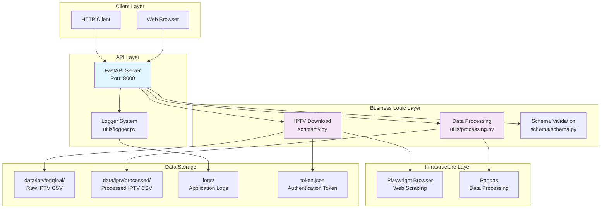

# IPTV Schedule API

An asynchronous API service for automatically downloading and processing IPTV schedule data.

## Project Architecture



## System Architecture Overview

### 1. API Layer (FastAPI)
- **Login Endpoint**: Authenticate and get access token
- **IPTV Endpoints**: Download and process IPTV schedule data

### 2. Business Logic Layer
- **IPTV Download**: Automated browser login and schedule data download
- **Data Processing**: Asynchronous cleaning, filtering, and formatting

### 3. Data Flow
```
User Request → Login (Get Token) → Download IPTV Data → Data Processing → Return JSON Response
```

## Features

- ✅ **IPTV Schedule Download**: Automatically download IPTV schedule data
- ✅ **Asynchronous Processing**: High-performance async API design
- ✅ **Intelligent Data Filtering**: Automatic football match filtering with date range support
- ✅ **Token-based Authentication**: Secure login and token management
- ✅ **Complete Logging System**: Structured logging with multi-level and multi-output support
- ✅ **Docker Containerization**: Docker deployment support with browser environment
- ✅ **RESTful API**: Standardized API design with comprehensive error handling

## Quick Start

### Requirements
- Python 3.12+
- Docker & Docker Compose
- Environment variables: `EMAIL`, `PASSWORD`

### Local Development

1. **Clone the project**
```bash
git clone <repository-url>
cd playwright_download
```

2. **Set environment variables**
```bash
cp .env.example .env
# Edit .env file and set necessary login credentials
```

3. **Install dependencies**
```bash
pip install -r requirements.txt
playwright install chromium
```

4. **Start the service**
```bash
python main.py
```

### Docker Deployment

```bash
docker-compose up -d
```

Access the service:
- API Documentation: http://localhost:8000/docs
- Health Check: http://localhost:8000/

## API Endpoints

### 1. Login
```http
GET /login
```

**Response**:
```json
{
  "token": "your_access_token",
  "device_uuid": "device_unique_id"
}
```

**Description**:
- Authenticates with IPTV website and retrieves access token
- Token is saved to `token.json` for subsequent API calls
- Token is automatically used by `/download-iptv` endpoint

**Usage Example**:
```bash
curl http://localhost:8000/login
```

### 2. IPTV Data Download
```http
POST /download-iptv
Content-Type: application/json

{
  "start_date": "16/09/2025",
  "end_date": "17/09/2025"
}
```

**Request Parameters**:
- `start_date`: Start date in `DD/MM/YYYY` format (e.g., "16/09/2025")
- `end_date`: End date in `DD/MM/YYYY` format (e.g., "17/09/2025")

**Response**:
```json
{
  "success": true,
  "message": "IPTV downloaded successfully",
  "data": [
    {
      "leagueName": "Premier League",
      "homeTeamName": "Team A",
      "awayTeamName": "Team B",
      "channel": "Channel Name",
      "kickoffTime": "2025-09-16T14:00:00.000Z",
      "alive": true,
      "status": false
    }
  ]
}
```

**Description**:
- Downloads IPTV schedule data for the specified date range
- Automatically uses token from `token.json` (login first if needed)
- Processes and filters data (football matches only)
- Returns processed data as JSON array

**Usage Example**:
```bash
# First, login to get token
curl http://localhost:8000/login

# Then download IPTV data
curl -X POST "http://localhost:8000/download-iptv" \
     -H "Content-Type: application/json" \
     -d '{
       "start_date": "16/09/2025",
       "end_date": "17/09/2025"
     }'
```

## Project Structure

```
playwright_download/
├── main.py                 # FastAPI application main file
├── docker-compose.yml      # Docker orchestration configuration
├── Dockerfile             # Docker image build
├── requirements.txt       # Python dependencies
├── .env                   # Environment variable configuration
├── .gitignore            # Git ignore file
├── token.json            # Authentication token storage
├── script/
│   └── iptv.py           # IPTV download service
├── utils/
│   ├── logger.py         # Logging configuration system
│   └── processing.py     # Data processing logic
├── schema/
│   └── schema.py         # Pydantic data models
├── data/
│   └── iptv/
│       ├── original/     # IPTV raw download files
│       └── processed/    # IPTV processed files
└── logs/                 # Application log files
```

## Configuration

### Environment Variables
```bash
# IPTV website credentials
EMAIL=your_iptv_email@example.com
PASSWORD=your_iptv_password

# Application settings
LOG_LEVEL=INFO
API_HOST=0.0.0.0
API_PORT=8000
HEADLESS=true
BROWSER_TIMEOUT=30000
```

## Data Processing Logic

### IPTV Data Processing
1. **Data Cleaning**: Remove unused columns (`EventId`)
2. **Type Filtering**: Keep only football matches (`Sport == "Soccer"`)
3. **Time Filtering**:
   - Convert `Start Date` to datetime format and add 8 hours (timezone adjustment)
   - Filter data within the specified date range (from `start_date 12:00PM` to `end_date 11:59AM`)
   - Format the date back to `MM/DD/YYYY HH:MM AM/PM` format
4. **Format Standardization**: Unify date-time format to `MM/DD/YYYY HH:MM AM/PM`
5. **Data Transformation**:
   - Rename columns: `Competition` → `leagueName`, `Home Team` → `homeTeamName`, `Away Team` → `awayTeamName`, `Channel` → `channel`
   - Convert `Start Date` to ISO format (`kickoffTime`)
   - Calculate `alive` status based on `Watch` field (verified status)
   - Calculate `status` based on match timing (within 2 hours after start)
   - Remove duplicate records based on team names and start date

## Logging System

- **Console Output**: Real-time log display
- **File Logging**: `logs/iptv_api_YYYY-MM-DD.log`
- **Error Logging**: `logs/iptv_api_error_YYYY-MM-DD.log`
- **Log Format**: Timestamp + Level + Filename + Line Number + Message

## Monitoring and Debugging

### Health Check
```bash
curl http://localhost:8000/
```

### View Logs
```bash
# Real-time logs
docker-compose logs -f

# Error logs
tail -f logs/iptv_api_error_$(date +%Y-%m-%d).log
```

### API Documentation
Visit http://localhost:8000/docs to view complete Swagger UI documentation

## Troubleshooting

### Common Issues
1. **IPTV Login Failed**: Check `EMAIL` and `PASSWORD` environment variables
2. **Token Not Found**: Call `/login` endpoint first to generate token
3. **Download Failed**: Check network connection and target website availability
4. **Processing Failed**: Check CSV file format and data integrity
5. **Date Format Error**: Ensure dates are in `DD/MM/YYYY` format

### Log Analysis
```bash
# View error logs
grep "ERROR" logs/iptv_api_*.log

# View specific operations
grep "download-iptv" logs/iptv_api_*.log
```

## Development Guide

### Adding New Features
1. Add business logic in corresponding modules
2. Update `schema/schema.py` data models
3. Add API endpoints in `main.py`
4. Add complete logging and error handling
5. Update documentation and tests

### Code Standards
- Use asynchronous programming (`async/await`)
- Complete error handling and logging
- Pydantic model validation
- Type hints (Type Hints)
- Follow RESTful API design principles

---


