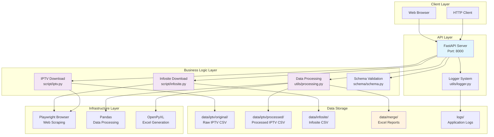

# IPTV Schedule API

一个用于自动下载和处理IPTV节目调度数据与Infosite数据，并生成Excel报告的异步API服务。

## 项目架构



## 系统架构说明

### 1. API层 (FastAPI)
- **IPTV端点**: 下载和处理IPTV调度数据
- **Infosite端点**: 下载Infosite比赛数据
- **合并端点**: 将数据合并生成Excel报告
- **文件管理**: 下载、列表、删除Excel文件
- **完整工作流**: 一键完成所有操作

### 2. 业务逻辑层
- **IPTV下载**: 自动化浏览器登录并下载调度数据
- **Infosite下载**: 下载UEFA Champions League等比赛数据
- **数据处理**: 异步清理、过滤和格式化数据
- **Excel生成**: 合并多数据源生成结构化报告

### 3. 数据流程
```
用户请求 → API验证 → 并发下载(IPTV+Infosite) → 数据处理 → Excel合并 → 文件下载
```

## 功能特性

- ✅ **双数据源下载**: 自动下载IPTV调度数据和Infosite比赛数据
- ✅ **异步并发处理**: 高性能的异步API设计，支持并发下载
- ✅ **智能数据过滤**: 自动过滤足球赛事，支持日期范围筛选
- ✅ **Excel报告生成**: 自动合并多数据源生成结构化Excel报告
- ✅ **完整日志系统**: 结构化日志记录，支持多级别和多输出
- ✅ **文件管理**: 完整的文件上传、下载、列表和删除功能
- ✅ **Docker容器化**: 支持Docker部署，包含浏览器环境
- ✅ **RESTful API**: 标准化的API设计，完整的错误处理

## 快速开始

### 环境要求
- Python 3.12+
- Docker & Docker Compose
- 环境变量: `EMAIL`, `PASSWORD`, `INFOSITE_USER`, `INFOSITE_PASSWORD`

### 本地开发

1. **克隆项目**
```bash
git clone <repository-url>
cd iptv-1
```

2. **设置环境变量**
```bash
cp .env.example .env
# 编辑 .env 文件，设置必要的登录凭据
```

3. **安装依赖**
```bash
pip install -r requirements.txt
playwright install chromium
```

4. **启动服务**
```bash
python main.py
```

### Docker部署

```bash
docker-compose up -d
```

访问服务:
- API文档: http://localhost:8000/docs
- 健康检查: http://localhost:8000/

## API端点

### 1. IPTV数据下载
```http
POST /download-iptv
Content-Type: application/json

{
  "start_date": "16/09/2025",
  "end_date": "17/09/2025",
  "filename": "schedule.csv"
}
```

### 2. Infosite数据下载
```http
POST /download-infosite
Content-Type: application/json

{
  "start_time": "2025-09-16",
  "end_time": "2025-09-17",
  "filename": "infosite_data",
  "leagues": ["UEFA Champions League"],
  "league_groups": ["European"],
  "sports": ["Soccer"],
  "save_features": ["match_info", "statistics"],
  "batch_size": 100
}
```

**参数说明**:
- `start_time`: 开始时间 (YYYY-MM-DD格式)
- `end_time`: 结束时间 (YYYY-MM-DD格式)
- `filename`: 输出文件名 (不含扩展名，系统会自动添加.xls)
- `leagues`: 具体联赛名称列表 (可选)
- `league_groups`: 联赛组别 (可选)
- `sports`: 运动类型 (可选)
- `save_features`: 保存的特征数据 (可选)
- `batch_size`: 批处理大小 (默认100)

**使用示例**:
```bash
# 基本下载
curl -X POST "http://localhost:8000/download-infosite" \
     -H "Content-Type: application/json" \
     -d '{
       "start_time": "2025-09-16",
       "end_time": "2025-09-17",
       "filename": "ucl_matches"
     }'

# 指定联赛下载
curl -X POST "http://localhost:8000/download-infosite" \
     -H "Content-Type: application/json" \
     -d '{
       "start_time": "2025-09-16",
       "end_time": "2025-09-17",
       "filename": "european_matches",
       "leagues": ["UEFA Champions League", "UEFA Europa League"],
       "sports": ["Soccer"]
     }'

# 检查可用联赛
curl -X POST "http://localhost:8000/check-leagues" \
     -H "Content-Type: application/json" \
     -d '{
       "start_time": "2025-09-16",
       "end_time": "2025-09-17",
       "league_groups": ["European"]
     }'
```

### 3. 数据合并
```http
POST /merge-to-excel
Content-Type: application/json

{
  "iptv_path": "./data/iptv/processed/processed_schedule.csv",
  "infosite_path": "./data/infosite/infosite_data.xls",
  "output_filename": "merged_report.xlsx"
}
```

### 4. 文件管理
```http
GET /excel-files                           # 列出所有Excel文件
GET /infosite-files                       # 列出所有Infosite文件
GET /download-excel?data_type=merge&filename=report.xlsx    # 下载合并的Excel文件
GET /download-excel?data_type=infosite&filename=data.xls    # 下载Infosite文件
POST /check-leagues                       # 检查可用联赛
```

**文件下载示例**:
```bash
# 下载合并的Excel文件
curl "http://localhost:8000/download-excel?data_type=merge&filename=report.xlsx" -O

# 下载Infosite原始文件
curl "http://localhost:8000/download-excel?data_type=infosite&filename=data.xls" -O

# 列出所有Excel文件
curl "http://localhost:8000/excel-files"

# 列出所有Infosite文件
curl "http://localhost:8000/infosite-files"
```

## 项目结构

```
iptv-1/
├── main.py                 # FastAPI应用主文件
├── docker-compose.yml      # Docker编排配置
├── Dockerfile             # Docker镜像构建
├── requirements.txt       # Python依赖包
├── .env                   # 环境变量配置
├── .gitignore            # Git忽略文件
├── script/
│   ├── iptv.py           # IPTV下载服务
│   └── infosite.py       # Infosite下载服务
├── utils/
│   ├── logger.py         # 日志配置系统
│   └── processing.py     # 数据处理逻辑
├── schema/
│   └── schema.py         # Pydantic数据模型
├── data/
│   ├── iptv/
│   │   ├── original/     # IPTV原始下载文件
│   │   └── processed/    # IPTV处理后文件
│   ├── infosite/         # Infosite数据文件
│   ├── merge/            # 合并后的Excel文件
│   └── formula.xlsx      # Excel模板文件
└── logs/                 # 应用日志文件
```

## 配置说明

### 环境变量
```bash
# IPTV网站凭据
EMAIL=your_iptv_email@example.com
PASSWORD=your_iptv_password

# Infosite网站凭据
INFOSITE_USER=your_infosite_username
INFOSITE_PASSWORD=your_infosite_password

# 应用设置
LOG_LEVEL=INFO
API_HOST=0.0.0.0
API_PORT=8000
HEADLESS=true
BROWSER_TIMEOUT=30000
```

## 数据处理逻辑

### IPTV数据处理
1. **数据清理**: 删除无用列 (`EventId`)
2. **类型过滤**: 仅保留足球赛事 (`Sport == "Soccer"`)
3. **时间过滤**: 按指定日期范围筛选
4. **格式标准化**: 统一日期时间格式

### Infosite数据处理
1. **后台任务处理**: 使用FastAPI BackgroundTasks异步处理下载
2. **多参数配置**: 支持联赛、联赛组别、运动类型等多维度筛选
3. **批量处理**: 支持自定义batch_size进行批量数据处理
4. **灵活筛选**: 可选择特定联赛或联赛组别进行数据下载
5. **特征保存**: 支持选择性保存比赛特征和统计数据
6. **联赛检查**: 提供API检查指定时间段内的可用联赛
7. **文件格式**: 输出为.xls格式，兼容Excel和其他数据处理工具

**API特点**:
- **异步处理**: 下载任务在后台执行，不阻塞API响应
- **参数验证**: 使用Pydantic进行严格的参数验证
- **文件管理**: 自动管理输出文件的命名和存储
- **错误处理**: 完整的异常捕获和日志记录

**数据来源**: Infosite系统 (http://infosite.klt2u.oneback.net)
**支持格式**: XLS导出，包含完整的比赛信息和统计数据
**处理方式**: 后台异步处理，支持大批量数据下载

### Excel报告生成
1. **多Sheet结构**: IPTV数据和Infosite数据分别存储
2. **模板继承**: 基于预定义Excel模板
3. **数据验证**: 确保数据完整性和格式正确

## 日志系统

- **控制台输出**: 实时日志显示
- **文件日志**: `logs/iptv_api_YYYY-MM-DD.log`
- **错误日志**: `logs/iptv_api_error_YYYY-MM-DD.log`
- **日志格式**: 时间戳 + 级别 + 文件名 + 行号 + 消息

## 监控和调试

### 健康检查
```bash
curl http://localhost:8000/
```

### 查看日志
```bash
# 实时日志
docker-compose logs -f

# 错误日志
tail -f logs/iptv_api_error_$(date +%Y-%m-%d).log
```

### API文档
访问 http://localhost:8000/docs 查看完整的Swagger UI文档

## Infosite数据下载注意事项

### 重要说明
- **登录凭据**: 需要有效的Infosite系统账户 (`INFOSITE_USER`, `INFOSITE_PASSWORD`)
- **日期格式**: 使用 `YYYY-MM-DD` 格式 (例: `2025-09-16`)
- **文件名**: 只需提供文件名，系统会自动添加 `.xls` 扩展名
- **后台处理**: API立即返回，实际下载在后台进行
- **网络要求**: 需要能够访问 `infosite.klt2u.oneback.net` 域名
- **浏览器环境**: 需要Chromium浏览器环境支持

### API工作流程
1. **接收请求**: API接收下载参数并验证
2. **后台任务**: 创建BackgroundTask进行异步处理
3. **立即响应**: 返回成功响应，不等待下载完成
4. **文件生成**: 后台完成下载并保存为 `.xls` 文件
5. **文件访问**: 通过文件管理API获取下载的文件

### 参数配置
- **基本参数**: `start_time`, `end_time`, `filename` (必需)
- **筛选参数**: `leagues`, `league_groups`, `sports` (可选)
- **处理参数**: `save_features`, `batch_size` (可选)
- **联赛检查**: 使用 `/check-leagues` 端点查看可用联赛

### 数据特点
- **异步处理**: 大数据量下载不会阻塞API
- **灵活筛选**: 支持多维度数据筛选
- **批量处理**: 可配置批处理大小优化性能
- **格式兼容**: XLS格式兼容多种数据处理工具

## 故障排除

### 常见问题
1. **IPTV登录失败**: 检查 `EMAIL` 和 `PASSWORD` 环境变量
2. **Infosite登录失败**: 检查 `INFOSITE_USER` 和 `INFOSITE_PASSWORD` 环境变量
3. **下载失败**: 检查网络连接和目标网站可用性
4. **处理失败**: 检查CSV文件格式和数据完整性
5. **Excel生成失败**: 确保模板文件存在且格式正确
6. **比赛类型错误**: 确保使用正确的比赛名称格式

### 日志分析
```bash
# 查看错误日志
grep "ERROR" logs/iptv_api_*.log

# 查看特定操作
grep "complete-workflow" logs/iptv_api_*.log
```

## 开发指南

### 添加新功能
1. 在对应模块添加业务逻辑
2. 更新 `schema/schema.py` 数据模型
3. 在 `main.py` 添加API端点
4. 添加完整的日志记录和错误处理
5. 更新文档和测试

### 代码规范
- 使用异步编程 (`async/await`)
- 完整的错误处理和日志记录
- Pydantic模型验证
- 类型提示 (Type Hints)
- 遵循RESTful API设计原则

## 版本历史

- **v1.0.0**: 初始版本，基础IPTV下载功能
- **v1.1.0**: 添加异步处理和日志系统
- **v1.2.0**: Docker容器化和API优化
- **v1.3.0**: 添加Infosite数据下载
- **v1.4.0**: Excel报告生成和文件管理
- **v1.5.0**: 完整工作流程和并发处理

## 许可证

MIT License

## 贡献

欢迎提交Issue和Pull Request来改进这个项目。

---

**作者**: Robert Tseng
**更新时间**: 2025-09-17
