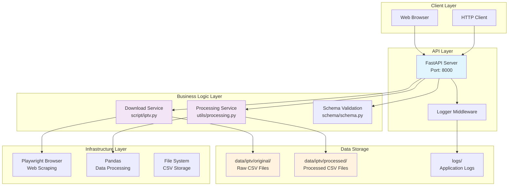

# IPTV Schedule API

一个用于自动下载和处理IPTV节目调度数据的异步API服务。

## 项目架构

## 系统架构说明

### 1. API层 (FastAPI)
- **端点**: `/download-iptv` - 下载并处理IPTV调度数据
- **端点**: `/schedules` - 列出所有调度文件
- **端点**: `/schedule/{filename}` - 获取特定调度文件内容
- **日志**: 完整的请求/响应日志记录

### 2. 业务逻辑层
- **下载服务**: 使用Playwright自动化浏览器操作
- **处理服务**: 异步数据清理和过滤
- **数据验证**: Pydantic模型验证输入输出

### 3. 数据流程
