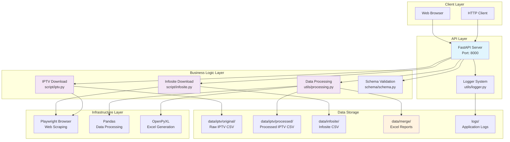

# IPTV Schedule API

An asynchronous API service for automatically downloading and processing IPTV schedule data and Infosite data, and generating Excel reports.

## Project Architecture



## System Architecture Overview

### 1. API Layer (FastAPI)
- **IPTV Endpoints**: Download and process IPTV schedule data
- **Infosite Endpoints**: Download Infosite match data
- **Merge Endpoints**: Merge data and generate Excel reports
- **File Management**: Download, list, and delete Excel files
- **Complete Workflow**: One-click completion of all operations

### 2. Business Logic Layer
- **IPTV Download**: Automated browser login and schedule data download
- **Infosite Download**: Download match data like UEFA Champions League
- **Data Processing**: Asynchronous cleaning, filtering, and formatting
- **Excel Generation**: Merge multiple data sources to generate structured reports

### 3. Data Flow
```
User Request → API Validation → Concurrent Download (IPTV+Infosite) → Data Processing → Excel Merge → File Download
```

## Features

- ✅ **Dual Data Source Download**: Automatically download IPTV schedule data and Infosite match data
- ✅ **Asynchronous Concurrent Processing**: High-performance async API design with concurrent download support
- ✅ **Intelligent Data Filtering**: Automatic football match filtering with date range support
- ✅ **Excel Report Generation**: Automatic merging of multiple data sources into structured Excel reports
- ✅ **Complete Logging System**: Structured logging with multi-level and multi-output support
- ✅ **File Management**: Complete file upload, download, list, and delete functionality
- ✅ **Docker Containerization**: Docker deployment support with browser environment
- ✅ **RESTful API**: Standardized API design with comprehensive error handling

## Quick Start

### Requirements
- Python 3.12+
- Docker & Docker Compose
- Environment variables: `EMAIL`, `PASSWORD`, `INFOSITE_USER`, `INFOSITE_PASSWORD`

### Local Development

1. **Clone the project**
```bash
git clone <repository-url>
cd iptv-1
```

2. **Set environment variables**
```bash
cp .env.example .env
# Edit .env file and set necessary login credentials
```

3. **Install dependencies**
```bash
pip install -r requirements.txt
playwright install chromium
```

4. **Start the service**
```bash
python main.py
```

### Docker Deployment

```bash
docker-compose up -d
```

Access the service:
- API Documentation: http://localhost:8000/docs
- Health Check: http://localhost:8000/

## API Endpoints

### 1. IPTV Data Download
```http
POST /download-iptv
Content-Type: application/json

{
  "start_date": "16/09/2025",
  "end_date": "17/09/2025",
  "filename": "schedule.csv"
}
```

### 2. Infosite Data Download
```http
POST /download-infosite
Content-Type: application/json

{
  "start_time": "2025-09-16",
  "end_time": "2025-09-17",
  "filename": "infosite_data",
  "leagues": ["UEFA Champions League"],
  "league_groups": ["European"],
  "sports": ["Soccer"],
  "save_features": ["match_info", "statistics"],
  "batch_size": 100
}
```

**Parameter Description**:
- `start_time`: Start time (YYYY-MM-DD format)
- `end_time`: End time (YYYY-MM-DD format)
- `filename`: Output filename (without extension, system will automatically add .xls)
- `leagues`: Specific league name list (optional)
- `league_groups`: League groups (optional)
- `sports`: Sport types (optional)
- `save_features`: Feature data to save (optional)
- `batch_size`: Batch processing size (default 100)

**Usage Examples**:
```bash
# Basic download
curl -X POST "http://localhost:8000/download-infosite" \
     -H "Content-Type: application/json" \
     -d '{
       "start_time": "2025-09-16",
       "end_time": "2025-09-17",
       "filename": "ucl_matches"
     }'

# Download specific leagues
curl -X POST "http://localhost:8000/download-infosite" \
     -H "Content-Type: application/json" \
     -d '{
       "start_time": "2025-09-16",
       "end_time": "2025-09-17",
       "filename": "european_matches",
       "leagues": ["UEFA Champions League", "UEFA Europa League"],
       "sports": ["Soccer"]
     }'

# Check available leagues
curl -X POST "http://localhost:8000/check-leagues" \
     -H "Content-Type: application/json" \
     -d '{
       "start_time": "2025-09-16",
       "end_time": "2025-09-17",
       "league_groups": ["European"]
     }'
```

### 3. Data Merging
```http
POST /merge-to-excel
Content-Type: application/json

{
  "iptv_path": "./data/iptv/processed/processed_schedule.csv",
  "infosite_path": "./data/infosite/infosite_data.xls",
  "output_filename": "merged_report.xlsx"
}
```

### 4. File Management
```http
GET /excel-files                           # List all Excel files
GET /infosite-files                       # List all Infosite files
GET /download-excel?data_type=merge&filename=report.xlsx    # Download merged Excel file
GET /download-excel?data_type=infosite&filename=data.xls    # Download Infosite file
POST /check-leagues                       # Check available leagues
```

**File Download Examples**:
```bash
# Download merged Excel file
curl "http://localhost:8000/download-excel?data_type=merge&filename=report.xlsx" -O

# Download Infosite raw file
curl "http://localhost:8000/download-excel?data_type=infosite&filename=data.xls" -O

# List all Excel files
curl "http://localhost:8000/excel-files"

# List all Infosite files
curl "http://localhost:8000/infosite-files"
```

## Project Structure

```
iptv-1/
├── main.py                 # FastAPI application main file
├── docker-compose.yml      # Docker orchestration configuration
├── Dockerfile             # Docker image build
├── requirements.txt       # Python dependencies
├── .env                   # Environment variable configuration
├── .gitignore            # Git ignore file
├── script/
│   ├── iptv.py           # IPTV download service
│   └── infosite.py       # Infosite download service
├── utils/
│   ├── logger.py         # Logging configuration system
│   └── processing.py     # Data processing logic
├── schema/
│   └── schema.py         # Pydantic data models
├── data/
│   ├── iptv/
│   │   ├── original/     # IPTV raw download files
│   │   └── processed/    # IPTV processed files
│   ├── infosite/         # Infosite data files
│   ├── merge/            # Merged Excel files
│   └── formula.xlsx      # Excel template file
└── logs/                 # Application log files
```

## Configuration

### Environment Variables
```bash
# IPTV website credentials
EMAIL=your_iptv_email@example.com
PASSWORD=your_iptv_password

# Infosite website credentials
INFOSITE_USER=your_infosite_username
INFOSITE_PASSWORD=your_infosite_password

# Application settings
LOG_LEVEL=INFO
API_HOST=0.0.0.0
API_PORT=8000
HEADLESS=true
BROWSER_TIMEOUT=30000
```

## Data Processing Logic

### IPTV Data Processing
1. **Data Cleaning**: Remove unused columns (`EventId`)
2. **Type Filtering**: Keep only football matches (`Sport == "Soccer"`)
3. **Time Filtering**: Filter by specified date range
4. **Format Standardization**: Unify date-time format

### Infosite Data Processing
1. **Background Task Processing**: Use FastAPI BackgroundTasks for asynchronous download processing
2. **Multi-parameter Configuration**: Support multi-dimensional filtering by leagues, league groups, sport types, etc.
3. **Batch Processing**: Support custom batch_size for batch data processing
4. **Flexible Filtering**: Option to select specific leagues or league groups for data download
5. **Feature Saving**: Support selective saving of match features and statistical data
6. **League Checking**: Provide API to check available leagues within specified time periods
7. **File Format**: Output in .xls format, compatible with Excel and other data processing tools

**API Features**:
- **Asynchronous Processing**: Download tasks execute in background without blocking API response
- **Parameter Validation**: Use Pydantic for strict parameter validation
- **File Management**: Automatically manage output file naming and storage
- **Error Handling**: Complete exception catching and logging

**Data Source**: Infosite System (http://infosite.klt2u.oneback.net)
**Supported Format**: XLS export with complete match information and statistical data
**Processing Method**: Background asynchronous processing, supports large-scale data downloads

### Excel Report Generation
1. **Multi-Sheet Structure**: IPTV data and Infosite data stored separately
2. **Template Inheritance**: Based on predefined Excel templates
3. **Data Validation**: Ensure data integrity and format correctness

## Logging System

- **Console Output**: Real-time log display
- **File Logging**: `logs/iptv_api_YYYY-MM-DD.log`
- **Error Logging**: `logs/iptv_api_error_YYYY-MM-DD.log`
- **Log Format**: Timestamp + Level + Filename + Line Number + Message

## Monitoring and Debugging

### Health Check
```bash
curl http://localhost:8000/
```

### View Logs
```bash
# Real-time logs
docker-compose logs -f

# Error logs
tail -f logs/iptv_api_error_$(date +%Y-%m-%d).log
```

### API Documentation
Visit http://localhost:8000/docs to view complete Swagger UI documentation

## Infosite Data Download Notes

### Important Information
- **Login Credentials**: Requires valid Infosite system account (`INFOSITE_USER`, `INFOSITE_PASSWORD`)
- **Date Format**: Use `YYYY-MM-DD` format (e.g., `2025-09-16`)
- **Filename**: Only provide the filename, system will automatically add `.xls` extension
- **Background Processing**: API returns immediately, actual download happens in background
- **Network Requirements**: Need access to `infosite.klt2u.oneback.net` domain
- **Browser Environment**: Requires Chromium browser environment support

### API Workflow
1. **Receive Request**: API receives download parameters and validates them
2. **Background Task**: Create BackgroundTask for asynchronous processing
3. **Immediate Response**: Return success response without waiting for download completion
4. **File Generation**: Background completes download and saves as `.xls` file
5. **File Access**: Access downloaded files through file management API

### Parameter Configuration
- **Basic Parameters**: `start_time`, `end_time`, `filename` (required)
- **Filter Parameters**: `leagues`, `league_groups`, `sports` (optional)
- **Processing Parameters**: `save_features`, `batch_size` (optional)
- **League Check**: Use `/check-leagues` endpoint to view available leagues

### Data Characteristics
- **Asynchronous Processing**: Large data downloads won't block API
- **Flexible Filtering**: Support multi-dimensional data filtering
- **Batch Processing**: Configurable batch size for performance optimization
- **Format Compatibility**: XLS format compatible with various data processing tools

## Troubleshooting

### Common Issues
1. **IPTV Login Failed**: Check `EMAIL` and `PASSWORD` environment variables
2. **Infosite Login Failed**: Check `INFOSITE_USER` and `INFOSITE_PASSWORD` environment variables
3. **Download Failed**: Check network connection and target website availability
4. **Processing Failed**: Check CSV file format and data integrity
5. **Excel Generation Failed**: Ensure template file exists and format is correct
6. **Match Type Error**: Ensure using correct match name format

### Log Analysis
```bash
# View error logs
grep "ERROR" logs/iptv_api_*.log

# View specific operations
grep "complete-workflow" logs/iptv_api_*.log
```

## Development Guide

### Adding New Features
1. Add business logic in corresponding modules
2. Update `schema/schema.py` data models
3. Add API endpoints in `main.py`
4. Add complete logging and error handling
5. Update documentation and tests

### Code Standards
- Use asynchronous programming (`async/await`)
- Complete error handling and logging
- Pydantic model validation
- Type hints (Type Hints)
- Follow RESTful API design principles

## Version History

- **v1.0.0**: Initial version with basic IPTV download functionality
- **v1.1.0**: Added asynchronous processing and logging system
- **v1.2.0**: Docker containerization and API optimization
- **v1.3.0**: Added Infosite data download
- **v1.4.0**: Excel report generation and file management
- **v1.5.0**: Complete workflow and concurrent processing

---

**Author**: Robert Tseng
**Last Updated**: 2025-09-17
